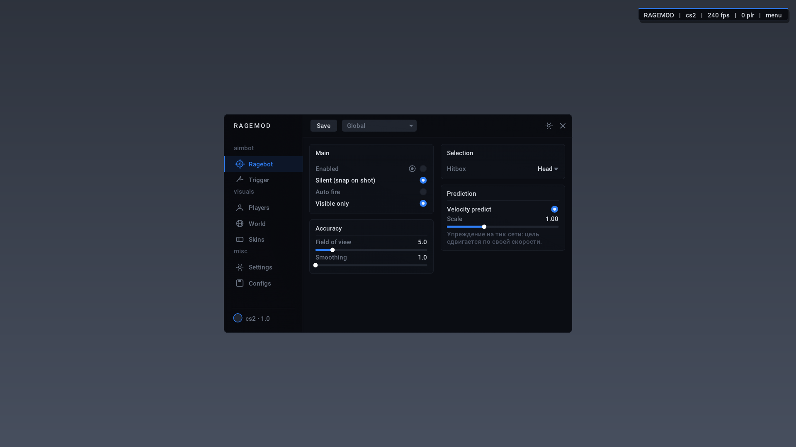
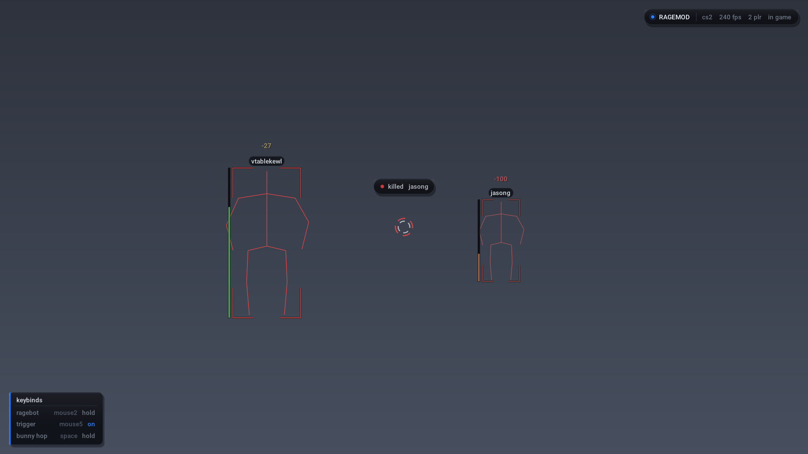
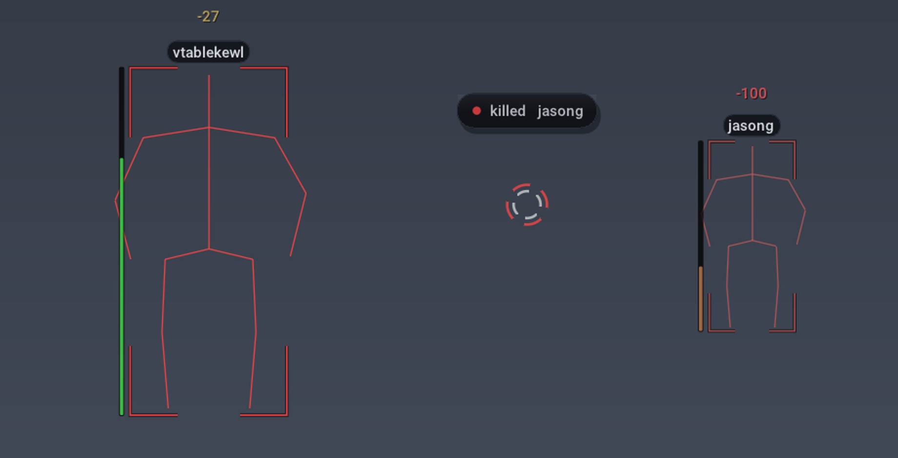
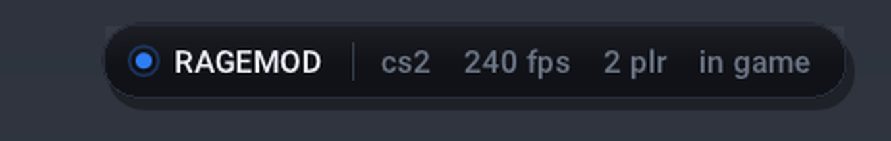
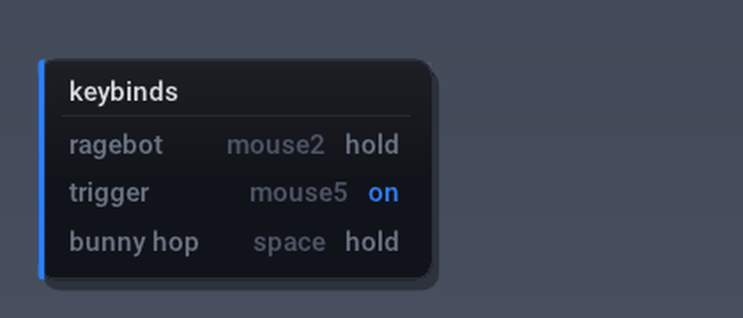
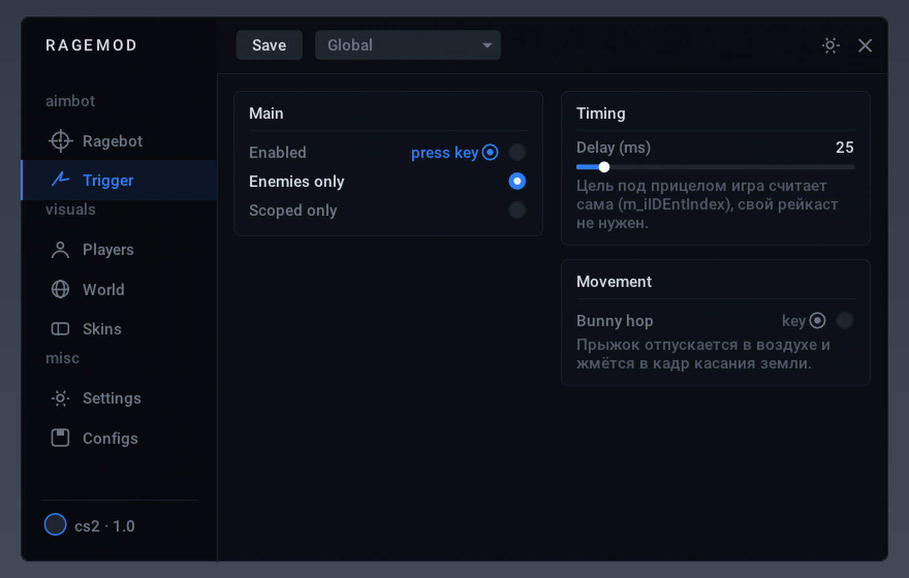

# RageMod — CS2 (внутренний, x64)

DLL под `cs2.exe`. Оффсеты не хардкожены руками: `tools/update_offsets.py` тянет свежий
дамп [cs2-dumper](https://github.com/a2x/cs2-dumper) и генерит `src/offsets_gen.h`.
Если Valve что-то переименовала — скрипт падает с именем поля, а не кладёт ноль в бинарь.



Худ в игре — ватермарка, список биндов, ESP уголками, хит-маркер и килл-плашка:






Меню с биндами:



## Что внутри

| | |
|---|---|
| Ragebot | аим по костям, FOV, silent (снап только на кадр выстрела), авто-огонь, упреждение по скорости цели |
| Trigger | цель под прицелом берём из `m_iIDEntIndex` — игра её считает сама, свой рейкаст не нужен; задержка, фильтр по команде, только в прицеле |
| Players | ESP: бокс, скелет, HP, ник, дистанция, фильтры; glow через `CGlowProperty` с типом подсветки и раздельными цветами для видимых и тех, кто за стеной |
| Hit effects | хит-маркер дугами, урон всплывает над целью, на добивание — скруглённая плашка «killed ник». Ловим просадку HP врага, авторство — по своему счётчику выстрелов |
| HUD | ватермарка-пилюля с живыми цифрами, список активных биндов с их состоянием (hold / on / off), всё на одной скруглённой плашке с тенью и рамкой |
| Movement | bunny hop: прыжок отпускается в воздухе и жмётся в кадр касания земли (`m_fFlags`, бит FL_ONGROUND) |
| World | night mode: затемнение сцены с настраиваемым оттенком, FOV-круг, ватермарка |
| Skins | подмена `m_nFallbackPaintKit` / seed / wear / StatTrak на активном оружии |
| Меню | один в один с референсом: сайдбар с логотипом и группами, шапка Save / Global, панели-группы, свои тумблеры, комбо, слайдеры, пикер цвета |
| Бинды | кружок слева от каждого тумблера: тап — и ловим клавишу или кнопку мыши, Delete снимает, Esc отменяет |

Ничего не включено на старте, кроме ESP.

## Сборка

```bash
./build.sh                 # -> build/win64/ragemod_cs2.dll
python3 tools/update_offsets.py   # перед сборкой после патча игры
```

Кросс-компиляция mingw-w64 с линукса или MSYS2 на винде. Рантайм линкуется статически,
никаких mingw-dll рядом не нужно. imgui и шрифт общие с модулем `standoff2`.

## Запуск

Любой инжектор x64 в `cs2.exe` (manual map предпочтительнее LoadLibrary).

- меню: **INSERT**
- выгрузиться: **END** (снимает хуки, возвращает WndProc, сохраняет конфиг)
- конфиг: `%APPDATA%\ragemod_cs2.json`

`// как часто VAC читает память клиента — не проверено; в матче работает серверный VAC Live. Внутренний чит — риск аккаунта.`

## Про «обход»

- рендер цепляем **подменой записи в vtable свопчейна** (Present, ResizeBuffers) — инлайн-патчей
  кода нет, сканы секций и проверки целостности `.text` тут ничего не видят;
- у dll нет экспортов, кроме `DllMain`, имя модуля в памяти ни на что не завязано;
- ввод кнопок — запись в структуру кнопки игры (адрес даёт cs2-dumper), не `SendInput`
  и не хуки `CreateMove`;
- никаких драйверов и сторонних runtime — одна самодостаточная dll.
- сборка без экспортов (`--exclude-all-symbols`), без символов и таймстампа, `-fno-ident`;
- humanizer (вкладка Ragebot, тумблер `Humanize`): пауза реакции на новую цель, шум угла ±0.12°,
  дельты углов квантуются шагом `0.022*sens` как у настоящей мыши, разброс по сглаживанию;
  триггер стреляет пачками со случайной задержкой, бхоп иногда приземляется с задержкой (`Hit chance`).

Это снижает поверхность клиента, но не делает чит невидимым: с 2026 VAC Live/VACnet
анализируют поведение на сервере, humanizer этого не отменяет. По сообщениям, фикс
VACnet от 29.07.2026 бил именно по рейдж-читам. Сводка с источниками — в корневом README,
раздел «Про анти-читы».

## Превью меню без игры

Тот же `ui.cpp` собирается на хосте с `-DRM_PREVIEW`, кадр растеризуется софтово в png:

```bash
./tools/preview/build_preview.sh 2 1920 1080   # вкладка, ширина, высота
```

## Что проверено, а что нет

Проверено здесь:

- dll собирается (PE32+ x64), линкуется статически, импортирует только d3d11/dxgi/d3dcompiler/user32;
- оффсеты сгенерированы из дампа cs2-dumper от 2026-10-23 и совпадают по именам классов;
- вёрстка меню — рендером реального кадра imgui в png (картинка выше).

**Не проверял в игре** (винды и CS2 у меня тут нет):

- индексы костей: взяты общепринятые для CS2 (голова 6, шея 5, таз 0), если скелет поедет —
  правятся в `sdk.h`, одно перечисление;
- семантика нажатия кнопки: пишем `0x5` / `0x4` в `buttons::attack + 0x8`, это ходовая схема,
  но на новой сборке могла измениться;
- обход списка сущностей (`entity_by_index`) — классическая схема CS2, но её тоже стоит
  сверить в первом же матче по счётчику игроков на вкладке Configs;
- silent aim честнее назвать снапом на кадр выстрела: угол пишем, стреляем, возвращаем.
  Полноценный silent требует перехвата `CUserCmd`, это следующий заход;
- скин-ченджер: поля fallback пишутся, но без форсированного обновления econ-item модель
  может не перерисоваться до респавна;
- bhop: сама схема (отпускать в воздухе, жать на земле) рабочая, но тайминг на 128-тике
  стоит проверить — возможно, понадобится пропускать кадр после касания.

## Чего пока нет

- **вид от третьего лица**: в схеме CS2 нет поля вроде `m_bIsThirdPerson`, камера ставится кодом.
  Нужен хук функции камеры, а для поиска паттерна нужен сам `client.dll`;
- **настоящие chams** (перекраска моделей, как на скриншотах memesense): это хук рендера моделей,
  тоже упирается в `client.dll`. Сейчас ближайшее по результату — glow с типом 3 и разными
  цветами для видимых и закрытых;
- **честный silent aim** — см. выше, перехват `CUserCmd`.
