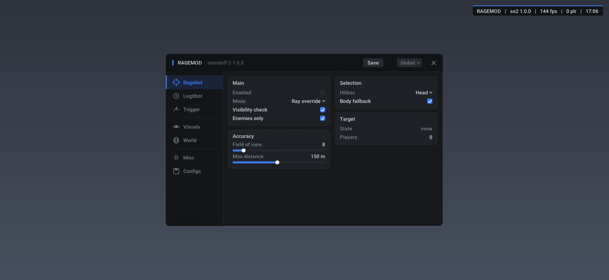

# RageMod — Standoff 2 (internal, arm64)

Внутренний чит под `com.axlebolt.standoff2` **1.0.0 arm64-v8a** (versionCode 203964).
Собран по дампу этой же сборки: `libunity.so` sha256
`a5d530e0ee7f4982d4bafec50c6109737b6119525935cac3e423e5145ff33e0f`.
Код il2cpp у SO2 слит в `libunity.so`, экспортов `il2cpp_*` нет — поэтому ни одного
рантайм-лукапа класса, всё по RVA и смещениям полей из `src/offsets.h`.

## Фичи

| | |
|---|---|
| ESP | бокс, скелет по `HitBoxCollider[]`, полоска HP, дистанция, снаплайны, фильтры по команде/видимости |
| Silent aim | правится сам хит-каст выстрела, камера не двигается. Два режима, см. ниже |
| Visible aim | пишет сетевые кватернионы `eir` локального игрока, smooth/FOV/бон |
| Auto fire | хук геттера кнопки: держать всегда или только когда цель в конусе, pulse для одиночных |
| No recoil | гасим `RecoilState` в `WeaponContext` после пересчёта, `RecoilMult` слайдером |
| Chams | материалы `OutlineMaterial`/`UntouchableMaterial` из `CharacterBindings` + render queue (видно через стены) |
| Third person | камера отводится назад после кадрового тика, с упором в геометрию, плюс включение своей модели |
| Меню | ImGui поверх `eglSwapBuffers` в стиле neverlose: сайдбар с иконками, панели-группы, свои чекбоксы/комбо/слайдеры, вшитый Roboto. Вкладки Ragebot / Legitbot / Trigger / Visuals / World / Misc / Configs |
| Ватермарка | плашка в углу в том же стиле, она же кнопка открытия меню |

Ничего не включено на старте, кроме ESP.



## Превью меню без телефона

Вёрстка меню гоняется на хосте: тот же `ui.cpp` собирается с `-DRM_PREVIEW`, кадр
растеризуется софтово и пишется в png.

```bash
./tools/preview/build_preview.sh 3 2340 1080   # вкладка, ширина, высота
# -> /tmp/rm-preview/preview-3.png
```

## Сборка

```bash
ANDROID_NDK=/path/to/android-ndk-r27c ./build.sh          # -> build/arm64/libragemod.so
ANDROID_NDK=/path/to/android-ndk-r27c ./pack_zygisk.sh    # -> dist/ragemod-zygisk.zip
```

## Как запустить

Железо: нужен **arm64 Android**. Либа arm64-v8a, и на BlueStacks Pie64 игра идёт через
ARM-трансляцию — инжект туда отдельный геморрой. Телефон или arm64-образ эмулятора
(AVD arm64, Waydroid arm64) проще на порядок.

### Без рута — репак apk (основной путь)

Нужны `apktool`, `java`, `apksigner`, `python3`, `adb`. Телефон подключён по USB с
включённой отладкой, рут не нужен — установленные apk вытаскиваются обычным `pm path`.

```bash
./repack.sh --device
# -> dist/base.apk + подписанные тем же ключом сплиты
adb uninstall com.axlebolt.standoff2
adb install-multiple dist/*.apk
```

Скрипт сам вытягивает все сплиты (`base` + `config.arm64_v8a` + ...), кладёт
`libragemod.so` в `lib/arm64-v8a/` базового apk, дописывает `System.loadLibrary("ragemod")`
в статический конструктор точки входа (своего `Application`, а если его нет —
launcher-активити), собирает и подписывает всё одним ключом. Патч smali идемпотентный.

Если apk уже лежат локально: `./repack.sh base.apk config.arm64_v8a.apk ...`

Что надо знать:

- подпись меняется, поэтому старую установку придётся снести — **данные игры уйдут**,
  аккаунт потом входить заново;
- если у Axlebolt есть серверная проверка подписи или целостности apk, такая сборка
  может не пустить в матч. Обойти это без рута нечем: подменить подпись умеет только
  Xposed/LSPatch, а он сам требует либо рута, либо того же репака;
- всё это можно сделать и с телефона: `Apktool M` или `MT Manager` делают распаковку,
  правку smali и подпись без ПК;
- ввод меню без рута идёт через `UnityEngine.Input` самой игры (см. «Управление»).

Если репак отвалится по проверке целостности — остаётся эмулятор с рутом (у LDPlayer и
MEmu рут переключателем), там работают и Zygisk-путь, и `/dev/input` для меню.

### С рутом — Zygisk-модуль

1. Magisk 24+, Zygisk включён.
2. `./pack_zygisk.sh` → `dist/ragemod-zygisk.zip`.
3. Magisk → Modules → Install from storage → zip → reboot.

Та же либа и есть модуль: Magisk грузит её в каждый форк зиготы, в чужих процессах она
сразу просит `DLCLOSE_MODULE_LIBRARY` и ничего не делает, поднимается только в
`com.axlebolt.standoff2`.

### С рутом — инжект в живой процесс

```bash
adb push build/arm64/libragemod.so /data/local/tmp/
adb shell su -c './inject -p $(pidof com.axlebolt.standoff2) -l /data/local/tmp/libragemod.so'
# или
frida -U -n com.axlebolt.standoff2 -e 'Module.load("/data/local/tmp/libragemod.so")'
```

Конструктор либы сверяет `/proc/self/cmdline` с именем пакета, так что грузить её в чужой
процесс безопасно — просто ничего не произойдёт.

## Управление

Меню открывается кнопкой `RAGE` в левом верхнем углу (без рута хоткеев нет — `/dev/input`
недоступен).

Два источника ввода, переключаются в MISC:

| `touch source` | как работает |
|---|---|
| `game input` (по умолчанию) | тач читаем из `UnityEngine.Input` managed-вызовом в игровом тике. Рут не нужен. Тап уходит и в игру, поэтому пока палец на меню хуки `znn.rpcp` / `znn.qvli` возвращают пустые кнопки и нулевые оси — игра его не видит (`Swallow input under menu`) |
| `/dev/input` | читаем панель напрямую: точнее и вообще не течёт в игру, плюс VOLUME DOWN как тоггл меню. **Нужен root.** Если тач смещён или перевёрнут — флаги `Swap XY / Invert X / Invert Y` там же |

- лог: `adb logcat -s RageMod`, при старте пишет `RageMod up (hooks 7/7)`
- конфиг: `/data/data/com.axlebolt.standoff2/files/ragemod.json`, вкладка CONFIG сохраняет/грузит
- после патча игры хуки не встанут: смотри «Под новый патч игры»

`// у SO2 свой анти-чит: внешнее чтение памяти он переживает, инжект в процесс — риск аккаунта.`

## Точки перехвата

| хук | RVA | зачем |
|---|---|---|
| `ios.lxcq()` | `0xA0903F4` | кадровый тик камеры локального игрока: сбор сущностей, W2S, visible aim |
| `jxy.vrsg(ref WeaponContext)` | `0x973A818` | выстрел — silent режим 0 |
| `jxy.rxjx(ref WeaponContext, Span<Ray>)` | `0x9739FA4` | лучи хит-каста — silent режим 1 |
| `ake.opmn()` | `0x949E8A0` | страховка на список игроков, если реестр мира развалится |
| `znn.rpcp(string)` | `0x8D441BC` | геттер состояния кнопки по имени экшена — автострельба |
| `znn.qvli(string)` | `0x8D3EF78` | геттер осей — глушим ввод под меню |
| `vez.lhgb(ref WeaponContext, bool)` | `0x9731070` | пересчёт отдачи — no recoil |
| `eglSwapBuffers` | GOT `libunity.so` | рендер меню и ESP |

Прологи всех семи игровых целей в этой сборке PC-независимы (проверено дизасмом),
поэтому inline-хук — простой 16-байтный патч `ldr x16,#8 / br x16/ .quad`, без движка хуков.
Если после патча игры пролог станет PC-зависимым, хук откажется ставиться и напишет в лог,
а не испортит код.

## Цепочки

```
ios  +0x18 -> ake (локальный игрок)       ios +0x20 -> njh (мир)
njh  +0x40 -> gat +0x30 -> gzx +0x18 -> yjk<krm>  (+0x10 массив, +0x18 count)
ake  +0x70 -> ylw (hp 0x10, maxhp 0x14, armor 0x16)   ake +0x90 team   ake +0x28 -> rct -> List<eur>
List<eur> -> элемент с klass->name == "jgi" -> +0x18 HitBoxCollider[]
HitBoxCollider +0x20 HumanBodyBones, Component.get_transform -> позиция бона
ios  +0x38 -> eir (+0x10 quat A, +0x20 quat B)
jgi  +0x30 -> CharacterBindings (+0x38 CharacterRenderer, +0x50 Untouchable, +0x58 Outline)
WeaponContext +0x40 RecoilContext.RecoilMult, +0x68 RecoilState (LastShotTime на +0x84 не трогаем)
```

## Что проверено, а что нет

Проверено по дампу и дизасму:

- смещения полей и RVA — сверены с `dump.cs` и `script.json` дампа 1.0.0;
- `eir.tgfv/rsxh` — тривиальные сеттеры (`stp s0,s1,[x0,#0x10]`), поэтому кватернионы пишем
  прямо в память;
- `WeaponContext` не обфусцирован: `HitTransform` на `+0x10`;
- слот `eglSwapBuffers` есть в `.rela.plt` libunity.so;
- прологи хук-целей;
- `CharacterBindings`, `WeaponContext`, `RecoilState`, `ButtonInput`, `AxisInput` не
  обфусцированы — поля и их смещения взяты из дампа как есть;
- `UnityEngine.InputLegacyModule.dll` лежит в дампе (476 DummyDll), то есть legacy-бэкенд
  ввода в сборку включён — поэтому `UnityEngine.Input.GetTouch` есть смысл звать вообще.

**Не проверял в игре** (дамп — это ELF установленной сборки, не рантайм):

- какой из двух silent-режимов реально переписывает выстрел. Режим 1 (`ray override`) правит
  уже готовые лучи, режим 0 (`hit transform`) доворачивает источник каста — проверяется
  переключателем в меню за один раунд;
- смысл отдельных флагов `qdp` (видимость игрока по мнению игры) — поэтому видимость считаем
  своим `Physics.Linecast`, а не флагом;
- что именно из двух кватернионов `eir` идёт на сервер — в меню выбор `quat A / B / both`;
- порядок осей тача на конкретном девайсе (касается только режима `/dev/input`);
- отдаёт ли `UnityEngine.Input` реальные тачи в этой сборке. Класс в билде есть, но если
  Active Input Handling стоит «New only», `touchCount` вернёт 0 — тогда остаётся режим
  `/dev/input` и рут. Фолбэк на `Input.mousePosition` в коде уже есть (эмулятор, мышь);
- имя input-экшена выстрела. Хук `znn.rpcp` логирует все имена, которые игра реально спрашивала,
  вкладка FIRE показывает их кнопками — ткнул, и автострельба привязалась к нужному;
- как выглядят chams с `OutlineMaterial`/`UntouchableMaterial` на SkinnedMeshRenderer. Если
  получится каша — режим `render queue` без подмены материала даёт просто модель через стены;
- на каком этапе кадра игра пересчитывает позицию камеры: третье лицо пишем после `ios.lxcq`,
  если камера всё равно дёргается — точку перехвата надо сдвинуть на `nrl.LateTick` (`0x98C81B0`).

## Под новый патч игры

1. Перегенерить дамп (`Il2CppDumper`/`Cpp2IL`) по новой `libunity.so`.
2. Обновить `src/offsets.h` — все магические числа только там.
3. Проверить прологи новых хук-целей (`llvm-objdump -d --start-address=...`); если PC-зависимы —
  сдвинуть точку перехвата на вложенный метод, как `iqkr` -> `lxcq`.
